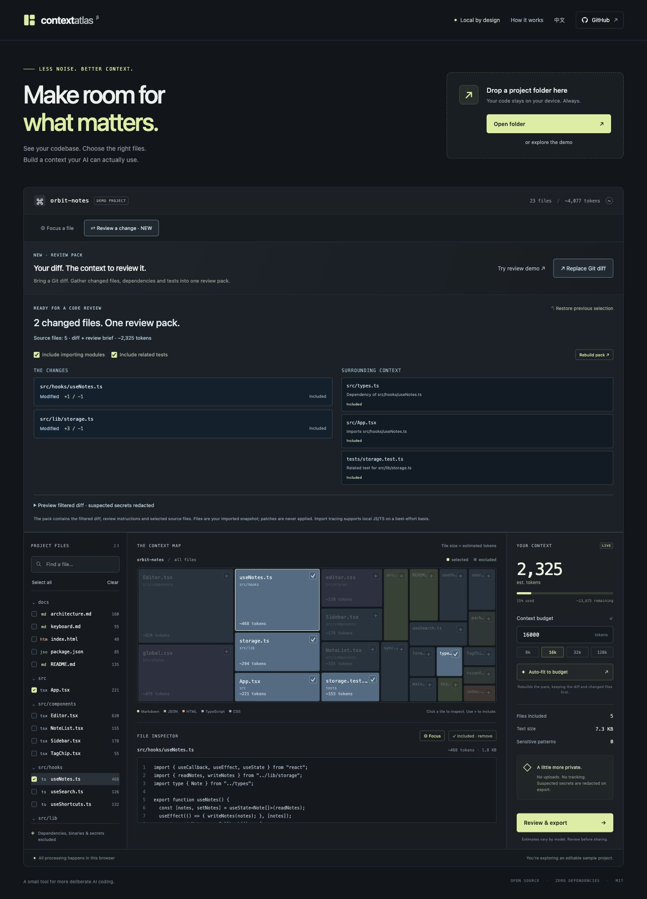
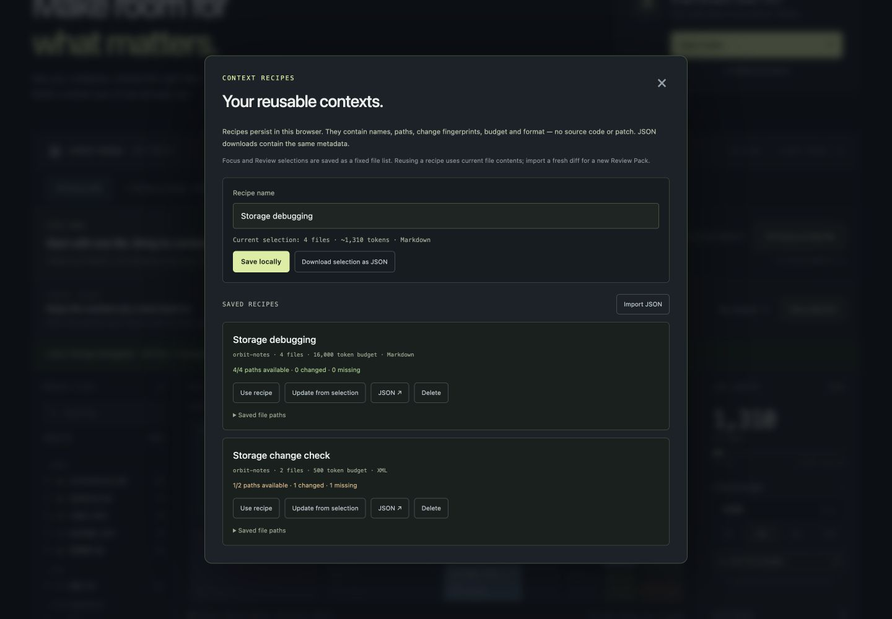

<p align="center">
  
</p>

<p align="center">
  <strong>Turn a Git diff into review-ready context.</strong>
</p>

<p align="center">
  A local-first context workbench for the moments before you paste a repository into an AI assistant.
</p>

<p align="center">
  <a href="LICENSE"></a>
  
  
  <a href="https://github.com/qsxustc/context-atlas/actions/workflows/ci.yml"></a>
  <a href="README.zh-CN.md">简体中文</a>
</p>

<p align="center">
  <a href="https://qsxustc.github.io/context-atlas/">Try the demo</a> · <a href="https://github.com/qsxustc/context-atlas">GitHub repository</a>
</p>

You know which problem you want an AI assistant to solve. Deciding which files to give it is harder. A large repository hides the useful parts among generated output, unrelated modules, and files that quietly consume half your context window.

**Context Atlas makes that choice visible.** Import a Git diff to build a **Review Pack**: the patch, current changed files, and related dependencies, imported-by modules, and tests in one budgeted bundle. Or pick a single file with **Focus Mode**. See why each file belongs, inspect what is missing, and export context for the AI assistant you already use. Everything runs locally.

Save a useful selection as a **Context Recipe** to make the next session faster. Reload your repository, apply the recipe to its current files, and check what has changed before exporting. Recipes work in the browser and CLI, so a repeatable context workflow can follow you from visual exploration to the terminal.

<p align="center">
  
</p>

### What you can do

- **Prepare an AI code review.** Import a Git diff, retain the changes and current changed files, and fit related context around them. Check missing files and patch/current-file mismatches before exporting.
- **Build context around a file.** Focus Mode follows supported JS/TS imports, finds modules that import the focus file and related tests, and explains each candidate.
- **Reuse context across sessions.** Save named Context Recipes with explicit file paths, a budget, and an export format. Reapply them to current files, inspect changed or missing paths, and move recipes between the browser and CLI as JSON.
- **Explore a repository visually.** A treemap turns estimated file token costs into something you can scan.
- **Choose your context deliberately.** Search the file list, select individual files, and see how much each choice costs.
- **Fit a budget.** Set a target and use automatic fitting to prepare a selection within the estimated budget.
- **Inspect before sharing.** Preview your context and apply local redaction for common secret patterns.
- **Export useful text.** Download a Markdown or XML bundle for the assistant or workflow you already use.
- **Start without a repository.** Open the built-in demo to try the workflow immediately.
- **Use English or 简体中文.** Switch the interface language in the app.

The app runs entirely in your browser. It has no backend, tracking, external fonts, or API-key requirement. Repository contents are read locally and are not uploaded by Context Atlas. Source and imported patch contents stay in memory; saved recipe names, project labels, paths, content fingerprints, budgets, and export formats persist in this site's browser storage until you delete them or clear its storage. Recipes contain no source text, patch text, or extracted credential values. The development tools and CLI also have **zero package dependencies**.

### Save a Context Recipe for next time

<p align="center">
  
</p>

1. Load your repository and prepare a selection manually, with Focus Mode, or with Review Pack.
2. Set the budget and export format, then save the selected files with a name such as “Storage changes” or “API debugging”.
3. In a later session, reload the repository and apply the recipe. Atlas selects matching current files and reports paths whose content has changed or that are unavailable under the current import rules.
4. Inspect the report and adjust the selection. Explicitly update the recipe from the current selection when you want to refresh its paths, settings, and fingerprint baseline.
5. Export recipe JSON for a backup or CLI use, or import a recipe created elsewhere.

The browser stores at most **30 recipes**, locally for the current site and browser profile. Reopening the page restores recipes, but you must import repository files again. Applying a recipe uses the current file contents and leaves its saved baseline intact until an explicit update. Fingerprints detect content differences; they do not identify a Git branch, prove file authenticity, or preserve a historical revision. Available paths are selected even when their content changed. Missing paths are reported rather than replaced with other files.

A recipe is a **files-only snapshot of a selection** and requires at least one selected current file. Saving a Focus or Review selection retains the selected file paths, rather than instructions to rebuild an import graph. It does not save the original diff, review notes, or source contents. Reapplying a Review-derived recipe exports current files only; import a fresh diff to prepare another Review Pack. Recipe JSON can expose file names and the name you chose, so inspect its metadata before sharing it. See [recipe behavior and limits](docs/architecture.md#context-recipes).

### Turn your changes into a Review Pack

1. [Try the Review Pack demo](https://qsxustc.github.io/context-atlas/?review=demo), or import your local repository and choose **Review a change**.
2. Paste or load a Git unified diff. Atlas identifies changed paths, keeps available changed files, and suggests related JS/TS dependencies, imported-by modules, and tests.
3. Review the change summary, selection reasons, omitted context, and any missing-file or patch-mismatch notices.
4. Export Markdown or XML containing the filtered patch, review notes, and selected current files. Common secret patterns are redacted in both the patch and file contents by default.

Generate a patch from the repository you want to review:

```sh
git diff --no-ext-diff --no-textconv HEAD > /tmp/change.patch
```

This includes tracked working-tree changes against `HEAD`; Git does not include untracked files in that command. Atlas reads the imported current files and never applies patches or checks out revisions. Load the working tree that matches the patch's new side. A mismatch notice means the checked hunk lines differ; no notice is not proof that the entire repository matches. The patch input is limited to 1 MiB and 500 file sections. Binary changes are skipped; combined merge diffs and malformed input are rejected. See [Review Pack limits](docs/architecture.md#review-pack).

### Try Focus Mode in a minute

1. [Try the Focus demo](https://qsxustc.github.io/context-atlas/?focus=src%2Flib%2Fstorage.ts), or inspect `src/lib/storage.ts` in the sample project and click **Focus on this file**.
2. Atlas finds its `src/types.ts` dependency, `src/hooks/useNotes.ts` as a module that imports it, and `tests/storage.test.ts`.
3. Review the reasons, adjust the imported-by and test options, and check any files omitted by the budget.
4. Preview, copy, or download the context for your AI assistant.

Focus follows module imports; it does not infer function calls or understand a task description. Import analysis supports JavaScript and TypeScript, including JSX/TSX and their module extensions. Related tests are suggested using direct imports or matching file names, with the reason shown. Rebuild explicitly after changing the budget or options, undo to return to the previous selection, or continue selecting files manually. Unresolved references and budget omissions need review. See the [analysis limits](docs/architecture.md#focus-mode) before relying on it for an unfamiliar project.

### Run locally

With **Node.js 20 or later**, clone or download this repository, then run:

```sh
git clone https://github.com/qsxustc/context-atlas.git
cd context-atlas
npm run dev
```

Open the URL printed in your terminal. No `npm install` step is needed.

The source uses browser ES modules, so serve it over HTTP using the included development server. Opening `index.html` through a `file://` URL is not supported.

### The one-minute workflow

1. Explore the built-in demo, select a local folder, or drag a folder into the app.
2. Explore the treemap and search for the part of the repository relevant to your task.
3. Inspect the file you're changing and build a focus selection, or select files manually.
4. Set your estimated token budget, rebuild the focus selection if needed, and review omitted files. General automatic fitting is also available.
5. Review the preview and redaction setting, then export Markdown or XML.

A folder picker is the easiest way to load a repository in a current desktop browser. Folder drag-and-drop support depends on your browser; use the picker if dragging does not work.

Browser imports are limited to **5,000 readable text files**, **1 MiB per file**, and **50 MiB of eligible text**. Default exclusions, custom ignore rules, and file validation run before a file counts toward the 5,000-file limit, so ignored, binary, oversized, or invalid UTF-8 files do not crowd out usable source files. Common dependencies, generated output, and credential files are excluded.

Root and nested `.gitignore` rules are supported on a best-effort basis. A directory-only rule such as `cache/` leaves a regular file named `cache` alone. Built-in exclusions remain in force, and rule length/count are bounded. Drag-and-drop enumerates at most **100,000 entries**, and browser imports accept at most **1 MiB of `.gitignore` text in total**. If a limit or read failure leaves a directory's ignore rules unknown, that directory is skipped. The app reports limited imports. See the [architecture notes](docs/architecture.md) for details.

### Use the CLI

Create a Markdown context bundle from a local repository:

```sh
node bin/context-atlas.js ./repo --budget 32000 --output context.md
```

For XML output, add `--format xml`. Omit `--output` to write the bundle to standard output. The CLI redacts common secret patterns by default; `--no-redact` disables that behavior. Run `node bin/context-atlas.js --help` for all options.

Build context around a specific file, relative to the input directory:

```sh
node bin/context-atlas.js ./repo --focus src/lib/storage.ts --budget 8000 --output storage-context.md
```

Add `--no-callers` to leave out modules that import the focus file, or `--no-tests` to leave out suggested tests. These flags require `--focus` or `--diff`. Without `--budget`, a focus export includes every related candidate. With a budget, it keeps the focus file and fits related files around it; if the focus file alone cannot fit, the command fails before writing output. Counts of omitted files and unresolved references are reported on standard error.

Build a Review Pack from a Git diff file:

```sh
# Run inside the repository being reviewed.
git diff --no-ext-diff --no-textconv HEAD > /tmp/change.patch
# Run from the Context Atlas checkout, with ./repo pointing to that repository.
node bin/context-atlas.js ./repo --diff /tmp/change.patch --budget 16000 --output review.md
```

Or pipe a diff directly to the CLI, using the path to your Context Atlas checkout:

```sh
git diff --no-ext-diff --no-textconv HEAD | node /path/to/context-atlas/bin/context-atlas.js . --diff - --budget 16000
```

`--diff` and `--focus` are mutually exclusive. Review exports always retain the filtered patch and available changed files; the budget also covers review notes and optional related context. If the mandatory content cannot fit, the command fails before writing output. Without `--budget`, all related candidates are included. `--no-callers` and `--no-tests` control optional context. Deletion-only patches can produce a pack even when no current files remain. Missing files, mismatches, skipped patch paths, omissions, and unresolved references are reported as counts on standard error.

Reuse a browser-exported or CLI-created recipe against a local repository:

```sh
node bin/context-atlas.js ./repo --recipe storage.recipe.json --output storage-context.md
```

The recipe's saved budget and format are defaults; explicit `--budget` and `--format` options override them. The CLI retains every saved path and uses its current content. It warns on standard error when fingerprints have changed, and fails before writing when a path is missing or ineligible, or the complete export exceeds the estimated budget. `--recipe` cannot be combined with `--focus`, `--diff`, `--no-callers`, or `--no-tests`. Redaction is enabled by default for every run; a recipe does not persist a redaction setting.

Save the final selected files as a portable recipe while creating a context bundle:

```sh
node bin/context-atlas.js ./repo --focus src/lib/storage.ts --budget 8000 \
  --save-recipe storage.recipe.json --recipe-name "Storage context" --output storage-context.md
```

`--save-recipe` also works with general selection, `--diff`, or `--recipe`; Review Pack saves its selected current files without the patch or generated notes. `--recipe-name` requires `--save-recipe`. Without an explicit or inherited recipe budget, saving chooses one that can cover the selected files, with a minimum of 16,000 estimated tokens. A recipe input must be a regular UTF-8 JSON file; both input JSON and serialized exports are limited to 1 MiB. Exports use compact JSON when formatting would exceed that limit. Input symlinks and standard input are unsupported. The CLI refuses to overwrite an existing save destination unless it is already a valid recipe, and rejects conflicting recipe, patch, and output destinations.

Without `--focus`, `--diff`, or `--recipe`, no `--budget` exports all eligible files, while a budget applies the general file-path selection heuristic.

The CLI skips symlinks, ignored paths, binary or non-UTF-8 files, and files over 1 MiB. It reads `.gitignore` from the input root and limits eligible text to 50 MiB per run; use a narrower directory if your repository exceeds that limit. The browser's 5,000-file cap does not apply to the CLI. The `--output`, `--diff`, `--recipe`, and `--save-recipe` paths are excluded from the repository scan, including when their parent paths use a symlink alias. Diff and recipe inputs must be regular UTF-8 files; the CLI rejects input symlinks. An unreadable, oversized, or symlinked root `.gitignore` stops the export because its rules cannot be safely determined. Diagnostics go to standard error so exported standard output can be piped into another command.

The CLI is useful when you want a context file directly from a terminal. The browser app is useful when you want to inspect and adjust the selection visually.

### How to interpret the budget

Token counts are **estimates**, not the output of a model-specific tokenizer. The budget includes the exported bundle's framing and file headers. Languages, source code, punctuation, and individual models can tokenize differently. Keep some room for your instructions, the conversation history, and the model's response.

General automatic fitting uses a file-path heuristic that prioritizes README files, configuration, entry points, and source files. Focus Mode uses supported import relationships around a chosen file; Review Pack combines those relationships around the current changed files. These methods do not understand your task, and a budget can exclude a useful dependency. Review the selection and any omission or unresolved-reference notices before exporting.

Local redaction recognizes common credential patterns. It cannot guarantee detection of every secret or sensitive detail. Redaction is enabled again when you load another project or restore the demo. Review the exported text before sharing it with another service.

### Build and verify

```sh
npm test
npm run build
npm run preview
```

Tests run with Node's built-in test runner. The build prepares a static site in a temporary directory before replacing `dist/`, so input validation or asset-copy failures leave the previous build intact. Deploy `dist/` to a static host, or use preview to serve it locally.

For the included GitHub Pages workflow, set **Repository Settings → Pages → Source → GitHub Actions**, then push to `main` or run the deployment workflow manually.

See [docs/architecture.md](docs/architecture.md) for the modules, data flow, and input limits, and [CHANGELOG.md](CHANGELOG.md) for release changes.

### Where it fits

There are excellent tools for preparing repository context, including [Repomix](https://github.com/yamadashy/repomix) and [Gitingest](https://github.com/coderamp-labs/gitingest), and projects that explore repositories visually, such as [Repo Atlas](https://github.com/rajathpi/repo-atlas).

Context Atlas focuses on the decision-making step: a visual workspace where you can inspect files, adjust a selection, and see its estimated context cost before exporting. Try the tools that fit your workflow; this project is intended to be a useful addition to that ecosystem.

### Contribute

Bug reports, accessible interaction improvements, clearer token estimates, and ideas grounded in real context-preparation workflows are welcome. See [CONTRIBUTING.md](CONTRIBUTING.md) for the local workflow.

Planning to share the project? [docs/launch.md](docs/launch.md) includes a release checklist and draft launch copy.

If Context Atlas helps you prepare better context, a star helps other people discover it.

### License

[MIT](LICENSE) — build on it, adapt it, and use it in your own workflow.
