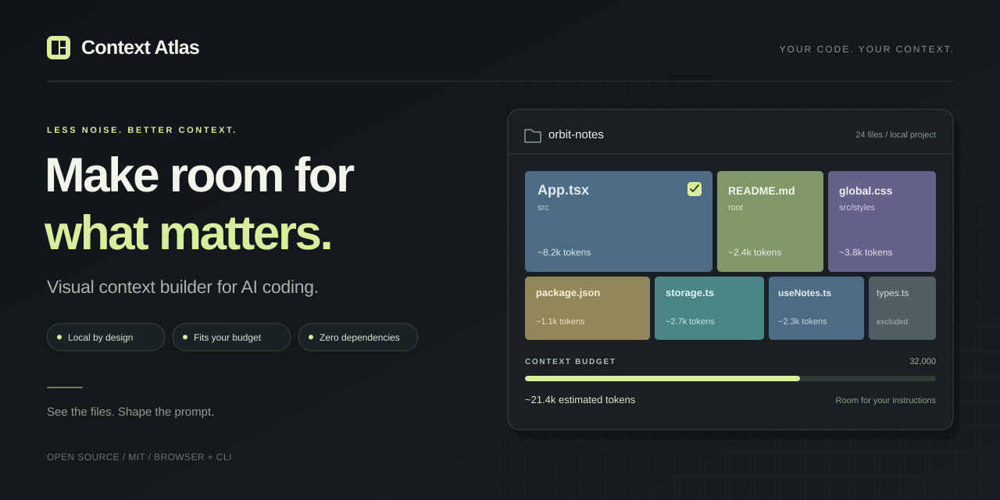
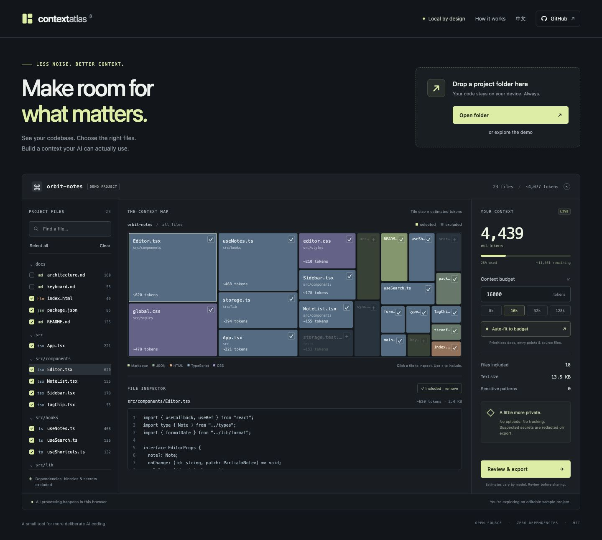

<p align="center">
  
</p>

<p align="center">
  <strong>See your codebase. Choose the context. Stay within budget.</strong>
</p>

<p align="center">
  A local-first context workbench for the moments before you paste a repository into an AI assistant.
</p>

<p align="center">
  <a href="LICENSE"></a>
  
  
  <a href="https://github.com/qsxustc/context-atlas/actions/workflows/ci.yml"></a>
  <a href="README.zh-CN.md">简体中文</a>
</p>

<p align="center">
  <a href="https://qsxustc.github.io/context-atlas/">Try the demo</a> · <a href="https://github.com/qsxustc/context-atlas">GitHub repository</a>
</p>

You know which problem you want an AI assistant to solve. Deciding which files to give it is harder. A large repository hides the useful parts among generated output, unrelated modules, and files that quietly consume half your context window.

**Context Atlas makes that choice visible.** Load a folder, explore its estimated context costs as a treemap, pick the files that matter, and export a prompt-ready context bundle. Watch the estimated token budget change as you work.

<p align="center">
  
</p>

### What you can do

- **Explore a repository visually.** A treemap turns estimated file token costs into something you can scan.
- **Choose your context deliberately.** Search the file list, select individual files, and see how much each choice costs.
- **Fit a budget.** Set a target and use automatic fitting to prepare a selection within the estimated budget.
- **Inspect before sharing.** Preview your context and apply local redaction for common secret patterns.
- **Export useful text.** Download a Markdown or XML bundle for the assistant or workflow you already use.
- **Start without a repository.** Open the built-in demo to try the workflow immediately.
- **Use English or 简体中文.** Switch the interface language in the app.

The app runs entirely in your browser. It has no backend, tracking, external fonts, or API-key requirement. Repository contents are read locally and are not uploaded by Context Atlas. The development tools and CLI also have **zero package dependencies**.

### Run locally

With **Node.js 20 or later**, clone or download this repository, then run:

```sh
git clone https://github.com/qsxustc/context-atlas.git
cd context-atlas
npm run dev
```

Open the URL printed in your terminal. No `npm install` step is needed.

The source uses browser ES modules, so serve it over HTTP using the included development server. Opening `index.html` through a `file://` URL is not supported.

### The one-minute workflow

1. Explore the built-in demo, select a local folder, or drag a folder into the app.
2. Explore the treemap and search for the part of the repository relevant to your task.
3. Select files and set your estimated token budget.
4. Use automatic fitting when your selection exceeds the budget, then review the result.
5. Review the preview and redaction setting, then export Markdown or XML.

A folder picker is the easiest way to load a repository in a current desktop browser. Folder drag-and-drop support depends on your browser; use the picker if dragging does not work.

Browser imports are limited to **5,000 readable text files**, **1 MiB per file**, and **50 MiB of eligible text**. Default exclusions, custom ignore rules, and file validation run before a file counts toward the 5,000-file limit, so ignored, binary, oversized, or invalid UTF-8 files do not crowd out usable source files. Common dependencies, generated output, and credential files are excluded.

Root and nested `.gitignore` rules are supported on a best-effort basis. A directory-only rule such as `cache/` leaves a regular file named `cache` alone. Built-in exclusions remain in force, and rule length/count are bounded. Drag-and-drop enumerates at most **100,000 entries**, and browser imports accept at most **1 MiB of `.gitignore` text in total**. If a limit or read failure leaves a directory's ignore rules unknown, that directory is skipped. The app reports limited imports. See the [architecture notes](docs/architecture.md) for details.

### Use the CLI

Create a Markdown context bundle from a local repository:

```sh
node bin/context-atlas.js ./repo --budget 32000 --output context.md
```

For XML output, add `--format xml`. Omit `--output` to write the bundle to standard output. The CLI redacts common secret patterns by default; `--no-redact` disables that behavior. Run `node bin/context-atlas.js --help` for all options.

Without `--budget`, the CLI exports all eligible files. With a budget, it applies the same selection heuristic as the browser app.

The CLI skips symlinks, ignored paths, binary or non-UTF-8 files, and files over 1 MiB. It reads `.gitignore` from the input root and limits eligible text to 50 MiB per run; use a narrower directory if your repository exceeds that limit. The browser's 5,000-file cap does not apply to the CLI. An existing `--output` file is excluded from its own export, including when its parent path uses a symlink alias. Diagnostics go to standard error so exported standard output can be piped into another command.

The CLI is useful when you want a context file directly from a terminal. The browser app is useful when you want to inspect and adjust the selection visually.

### How to interpret the budget

Token counts are **estimates**, not the output of a model-specific tokenizer. The budget includes the exported bundle's framing and file headers. Languages, source code, punctuation, and individual models can tokenize differently. Keep some room for your instructions, the conversation history, and the model's response.

Automatic fitting uses a file-path heuristic that prioritizes README files, configuration, entry points, and source files. It does not analyze your task or build a dependency graph. Review the selected files against the actual task: a small but unrelated file is still unrelated, and an omitted dependency may matter.

Local redaction recognizes common credential patterns. It cannot guarantee detection of every secret or sensitive detail. Redaction is enabled again when you load another project or restore the demo. Review the exported text before sharing it with another service.

### Build and verify

```sh
npm test
npm run build
npm run preview
```

Tests run with Node's built-in test runner. The build writes a static site to `dist/`, which can be deployed to a static host. Preview serves that build locally.

For the included GitHub Pages workflow, set **Repository Settings → Pages → Source → GitHub Actions**, then push to `main` or run the deployment workflow manually.

See [docs/architecture.md](docs/architecture.md) for the modules, data flow, and input limits, and [CHANGELOG.md](CHANGELOG.md) for release changes.

### Where it fits

There are excellent tools for preparing repository context, including [Repomix](https://github.com/yamadashy/repomix) and [Gitingest](https://github.com/coderamp-labs/gitingest), and projects that explore repositories visually, such as [Repo Atlas](https://github.com/rajathpi/repo-atlas).

Context Atlas focuses on the decision-making step: a visual workspace where you can inspect files, adjust a selection, and see its estimated context cost before exporting. Try the tools that fit your workflow; this project is intended to be a useful addition to that ecosystem.

### Contribute

Bug reports, accessible interaction improvements, clearer token estimates, and ideas grounded in real context-preparation workflows are welcome. See [CONTRIBUTING.md](CONTRIBUTING.md) for the local workflow.

Planning to share the project? [docs/launch.md](docs/launch.md) includes a release checklist and draft launch copy.

If Context Atlas helps you prepare better context, a star helps other people discover it.

### License

[MIT](LICENSE) — build on it, adapt it, and use it in your own workflow.
