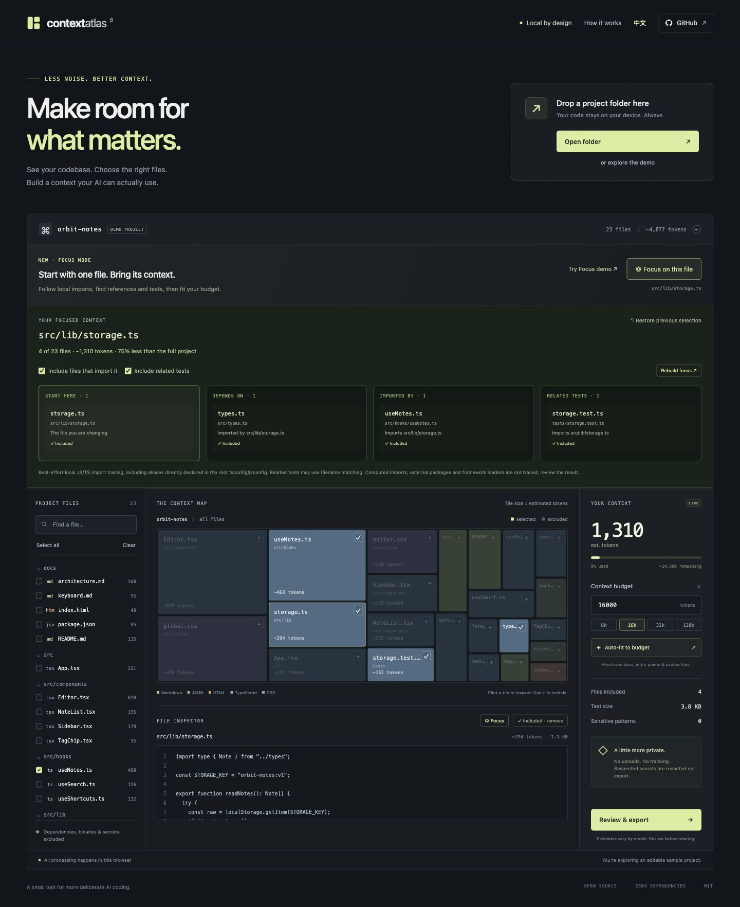

<p align="center">
  
</p>

<p align="center">
  <strong>选一个文件，找到相关上下文，控制输入预算。</strong>
</p>

<p align="center">
  一个在本地运行的 AI 上下文工作台，帮助你在把代码交给 AI 之前，决定该提供哪些文件。
</p>

<p align="center">
  <a href="README.md">English</a> · <a href="LICENSE">MIT 开源</a> · 零依赖 · 文件内容留在本地
</p>

<p align="center">
  <a href="https://qsxustc.github.io/context-atlas/">在线体验</a> · <a href="https://github.com/qsxustc/context-atlas">GitHub 仓库</a>
</p>

你已经知道要让 AI 解决什么问题，但一个代码库里可能有几百个文件：相关模块、生成文件、辅助工具，还有一个不知不觉占掉大量上下文的大文件。哪些应该放进去，哪些可以省略，往往需要反复判断。

**Context Atlas 把这个判断过程变成可视化操作。** 选择正在修改的文件，用 **Focus Mode（聚焦模式）** 找出本地依赖、引用它的模块和相关测试。查看每个文件的选择原因，检查因预算不足而省略的内容，再导出可直接交给 AI 的上下文。整个过程在本地完成。

<p align="center">
  
</p>

### 可以做什么

- **围绕一个文件准备上下文。** 聚焦模式分析支持的 JS/TS import 关系，找出引用该文件的模块和相关测试，并解释候选文件的来源。
- **可视化浏览代码库。** 用矩形树图直观查看各文件的粗估 token 成本及分布。
- **精确选择上下文。** 搜索文件、逐个勾选，并查看选择对预算的影响。
- **控制输入预算。** 设置目标 token 数，用自动适配生成粗估预算内的文件选择。
- **分享前检查。** 预览上下文，并在本地对常见密钥模式进行脱敏。
- **导出文本。** 下载 Markdown 或 XML 上下文，接入你已经在使用的 AI 工作流。
- **直接试用。** 内置示例项目，无需先准备自己的代码库。
- **切换语言。** 界面支持 English 与简体中文。

应用完全在浏览器里运行，没有后端、追踪统计、外部字体，也不需要 API Key。Context Atlas 在本地读取仓库文件，不上传文件内容。开发工具与 CLI 同样**没有第三方包依赖**。

### 一分钟体验聚焦模式

1. [体验聚焦示例](https://qsxustc.github.io/context-atlas/?focus=src%2Flib%2Fstorage.ts)，或在示例项目中选中 `src/lib/storage.ts`，点击 **围绕此文件构建**。
2. Atlas 会找到它依赖的 `src/types.ts`、引用它的 `src/hooks/useNotes.ts`，以及 `tests/storage.test.ts`。
3. 检查选择原因，调整是否包含引用方和测试，并查看因预算不足而省略的文件。
4. 预览、复制或下载上下文，交给你使用的 AI 助手。

聚焦模式分析模块 import 关系，不推断函数调用，也不理解任务描述。导入分析支持 JavaScript、TypeScript，以及 JSX/TSX 和相应的模块扩展名。相关测试通过直接 import 或文件名匹配进行推荐，界面会说明匹配方式。修改预算或选项后可点击重新构建，也可以撤销到此前的选择，或继续手动勾选。未解析的引用和预算遗漏需要检查。处理陌生项目时，可先了解[分析范围与限制](docs/architecture.md#focus-mode)。

### 本地运行

需要 **Node.js 20 或更高版本**。克隆或下载仓库后运行：

```sh
git clone https://github.com/qsxustc/context-atlas.git
cd context-atlas
npm run dev
```

在浏览器中打开终端输出的地址即可，**不需要先执行 `npm install`**。

源码使用浏览器 ES Modules，需要通过 HTTP 服务加载。请使用自带开发服务器，不支持直接双击 `index.html` 以 `file://` 方式打开。

### 一分钟上手

1. 探索内置示例、选择本地文件夹，或把文件夹拖入应用。
2. 查看矩形树图，搜索与当前任务相关的文件。
3. 选中正在修改的文件，构建聚焦上下文，或手动勾选文件。
4. 设置估算的 token 预算，按需重新构建聚焦选择并检查遗漏。通用的自动适配功能仍然可用。
5. 查看预览与脱敏设置，导出 Markdown 或 XML。

建议在较新的桌面浏览器中使用文件夹选择器。文件夹拖放的支持程度取决于浏览器；拖放不可用时可改用选择器。

浏览器每次最多导入 **5,000 个可读取的文本文件**，单文件不超过 **1 MiB**，符合条件的文本总量不超过 **50 MiB**。默认排除规则、自定义忽略规则和文件校验先执行，通过后才计入 5,000 个文件的上限，因此被忽略的文件、二进制、超大文件和无效 UTF-8 不会挤占可用源码的名额。常见依赖目录、生成文件和凭据文件会被排除。

根目录与嵌套目录的 `.gitignore` 规则提供尽力支持。`cache/` 这类仅针对目录的规则不会排除名为 `cache` 的普通文件。默认排除规则仍然生效，并限制自定义规则的长度和数量。拖放导入最多枚举 **100,000 个条目**；浏览器每次接受的 `.gitignore` 文本总量不超过 **1 MiB**。如果触及限制或读取失败导致无法确认某个目录的忽略规则，该目录会被跳过。界面会提示导入受到限制。详情见[架构说明](docs/architecture.md)。

### CLI 用法

在终端中从本地仓库生成 Markdown 上下文文件：

```sh
node bin/context-atlas.js ./repo --budget 32000 --output context.md
```

XML 输出可以加上 `--format xml`。不指定 `--output` 时，内容写入标准输出。CLI 默认对常见密钥模式脱敏，可以用 `--no-redact` 关闭；运行 `node bin/context-atlas.js --help` 查看全部选项。

围绕一个指定文件构建上下文，路径相对于输入目录：

```sh
node bin/context-atlas.js ./repo --focus src/lib/storage.ts --budget 8000 --output storage-context.md
```

添加 `--no-callers` 可排除引用焦点文件的模块，`--no-tests` 可排除推荐的测试；这两个选项需要与 `--focus` 一起使用。聚焦导出不指定 `--budget` 时包含所有相关候选文件；指定预算时保留焦点文件，并根据剩余预算选择相关文件。如果焦点文件本身放不下，命令会在写入输出前报错。遗漏文件数和未解析引用数写入标准错误。

不指定 `--focus` 时保持原有行为：没有 `--budget` 就导出所有符合过滤条件的文件；指定预算时使用通用的文件路径选择规则。

CLI 跳过符号链接、过滤路径、二进制或非 UTF-8 文件，以及大于 1 MiB 的文件。它读取输入根目录的 `.gitignore`，每次最多处理 50 MiB 的符合条件文本，超出时可缩小输入目录。浏览器的 5,000 文件数量上限不适用于 CLI。已有的 `--output` 文件不会被再次打包，即使其父目录路径经过符号链接别名。运行信息写入标准错误，不会混入标准输出中的导出文本，便于管道调用。

需要直接生成上下文文件时可以使用 CLI；需要观察和调整文件选择时可以使用浏览器界面。

### 如何理解预算

token 数量是**粗略估算**，不是某个模型的真实 tokenizer 计算结果。预算包含导出文本的结构标记与文件标题。中文、源码、标点以及不同模型的切分方式都可能影响实际用量。请为任务说明、聊天历史和模型输出留出空间。

通用自动适配根据文件路径，优先考虑 README、配置、入口和源码文件；聚焦模式根据选中文件周围受支持的 import 关系选择文件。两种方式都不理解具体任务，预算也可能导致有用的依赖被省略。导出前仍需检查选择结果、预算遗漏和未解析引用提示。

本地脱敏针对常见凭据模式，不能保证识别所有密钥或敏感信息。载入其他项目或恢复示例项目时，脱敏会重新默认开启。交给其他服务之前，请检查导出的内容。

### 构建与验证

```sh
npm test
npm run build
npm run preview
```

测试使用 Node 内置测试运行器。构建产物位于 `dist/`，可以部署到静态网站托管服务；preview 命令用于在本地预览构建产物。

使用仓库自带的 GitHub Pages 工作流时，先在 **Repository Settings → Pages → Source** 中选择 **GitHub Actions**，再推送到 `main` 或手动运行部署工作流。

模块、数据流和输入限制的说明见 [docs/architecture.md](docs/architecture.md)，版本变更见 [CHANGELOG.md](CHANGELOG.md)。

### 项目定位

仓库上下文准备已有很好的开源工具，例如 [Repomix](https://github.com/yamadashy/repomix) 和 [Gitingest](https://github.com/coderamp-labs/gitingest)；也有 [Repo Atlas](https://github.com/rajathpi/repo-atlas) 这样的仓库可视化项目。

Context Atlas 专注于准备上下文时的选择过程：在可视化界面里查看文件、调整勾选范围，并在导出前了解估算成本。欢迎选择最适合自己工作流的工具，也欢迎一起完善这个项目。

### 参与贡献

欢迎提交 bug、改进无障碍交互、完善估算方式，或提出来自实际上下文准备流程的需求。开发流程见 [CONTRIBUTING.md](CONTRIBUTING.md)。

发布检查清单和分享文案草稿见 [docs/launch.md](docs/launch.md)。

如果这个工具帮你更好地准备 AI 上下文，可以点一个 star，让更多人发现它。

### 许可证

[MIT](LICENSE)。你可以使用、修改，并在自己的项目中继续开发。
